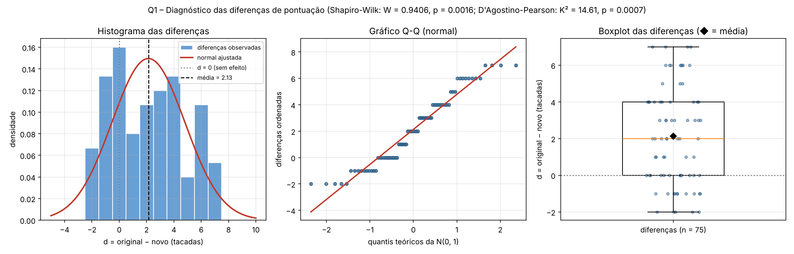
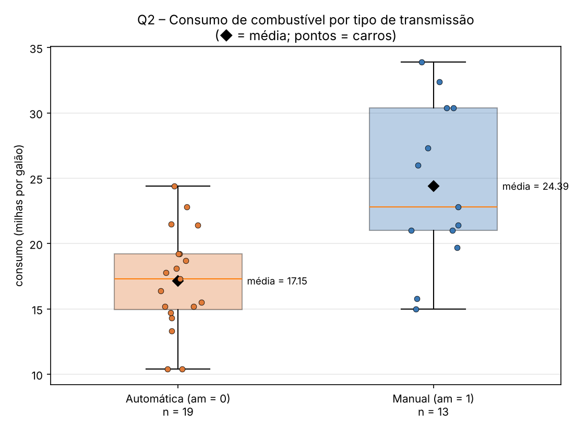
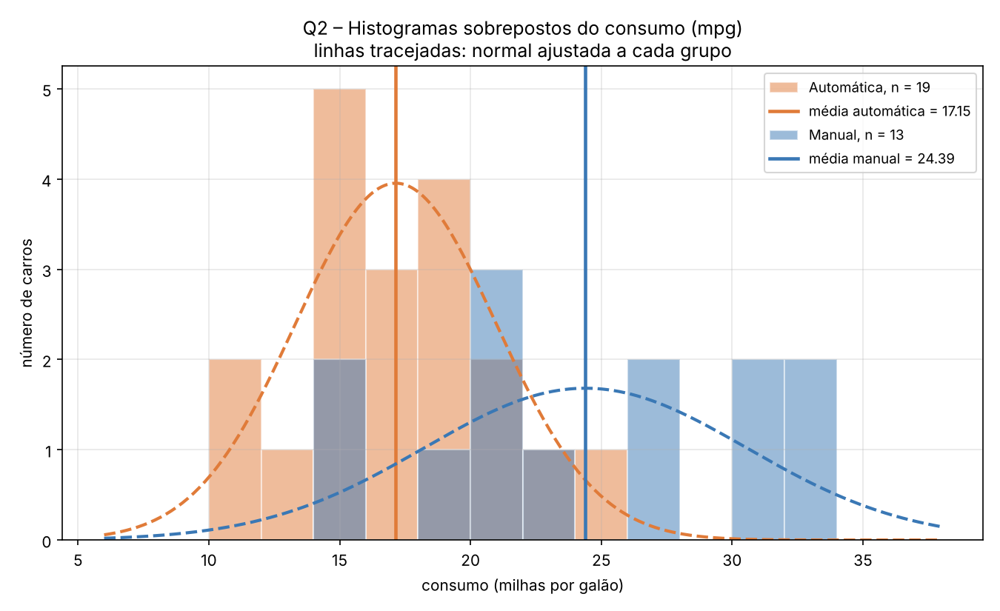
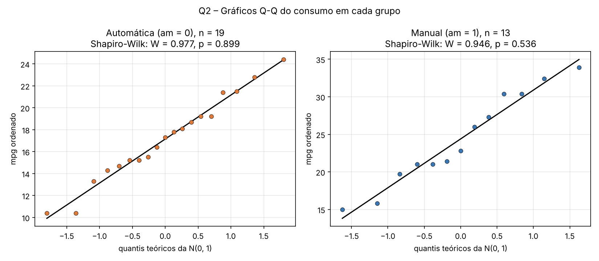
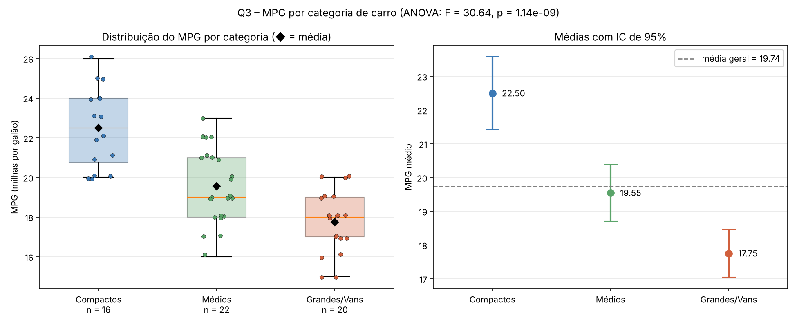
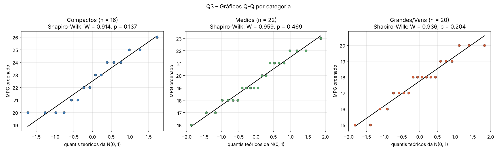
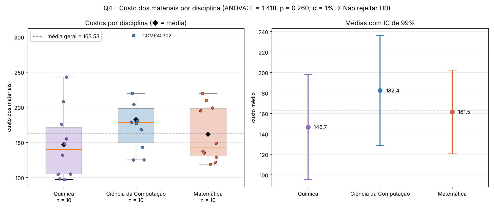
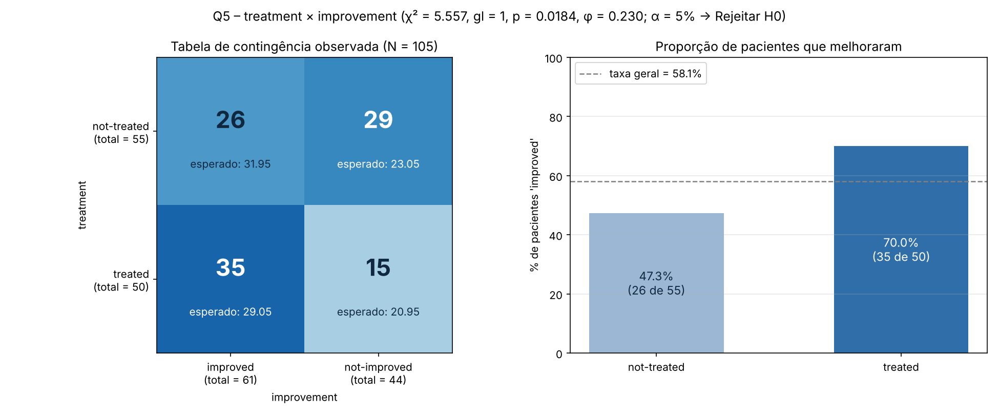

# GCC1625 – Inferência Estatística – Trabalho 02

**Aluno:** Matheus Kubrusly de Miranda Montenegro da Silva

**Disciplina:** GCC1625 – Inferência Estatística (Prof. Eduardo Bezerra) – CEFET/RJ, 2026.2

## Organização e procedimento geral

Cada questão está em um script independente (`q1_tacos_golfe.py` a `q5_qui_quadrado.py`), executado a partir da raiz da entrega com `python qN_....py`. Os scripts leem os dados em `data/` por caminhos relativos, criam a pasta `resultados/` se ela não existir, gravam os valores numéricos em `resultados/qN_resultados.json` e salvam os gráficos em PNG. Eles também imprimem no terminal um resumo dos cálculos, na mesma ordem em que os resultados aparecem neste arquivo.

Em todos os testes segui os quatro passos vistos nas notas de aula:

1. declarar as hipóteses $H_0$ e $H_a$ (a direção de $H_a$ vem da pergunta do problema, e não dos dados);
2. calcular a estatística de teste a partir da amostra;
3. encontrar o p-valor na distribuição da estatística sob $H_0$;
4. comparar o p-valor com $\alpha$ (rejeitar $H_0$ se $p \le \alpha$; caso contrário, não rejeitar) e interpretar a decisão no contexto do problema.

Sempre que possível calculei a estatística pelas fórmulas e conferi com a função pronta do `scipy.stats`. Também informo o valor crítico de cada teste, para mostrar que a decisão pela região crítica é a mesma da decisão pelo p-valor. Os números do texto estão arredondados; os valores completos estão nos arquivos JSON.

---

## Q1 – Um estilo diferente ajuda?

Arquivos: `q1_tacos_golfe.py`, `resultados/q1_resultados.json` e `resultados/q1_diferencas.png`.

O `golfe.csv` tem três colunas (`ID`, `Old Score` e `New Score`), separadas por ponto e vírgula. Cada linha é um jogador: a pontuação da rodada com os tacos originais e a pontuação dois meses depois, com os tacos novos. Como as duas medidas são do mesmo jogador, as amostras não são independentes, e a análise deve ser feita sobre a diferença de cada par. Defini

$$d_i = \text{original}_i - \text{novo}_i$$

porque no golfe uma pontuação menor (menos tacadas) é melhor. Assim, $d_i > 0$ indica que o jogador melhorou com o taco novo, e a alegação de que o novo taco ajuda corresponde a $\mu_d > 0$.

| Medida | Valor |
|---|---|
| Jogadores (n) | 75 |
| Média com o taco original | 74,87 |
| Média com o taco novo | 72,73 |
| Média das diferenças $\bar d$ | 2,133 tacadas |
| Desvio padrão das diferenças $s_d$ | 2,668 |
| Erro padrão $s_d/\sqrt{n}$ | 0,308 |
| Melhoraram / empataram / pioraram | 48 / 12 / 15 |

### Q1 (i) – Normalidade das diferenças

Testei a normalidade das 75 diferenças, e não das duas colunas separadamente, porque o t-teste pareado é um t-teste de uma amostra aplicado aos $d_i$. Usei os dois testes estatísticos estudados no curso, com $\alpha = 5\%$:

- $H_0$: as diferenças vêm de uma distribuição normal;
- $H_a$: as diferenças não vêm de uma distribuição normal.

| Teste | Estatística | p-valor | Decisão a 5% |
|---|---|---|---|
| Shapiro-Wilk | W = 0,9406 | 0,0016 | rejeita $H_0$ |
| D'Agostino-Pearson | K² = 14,61 | 0,0007 | rejeita $H_0$ |

Os dois p-valores ficaram bem abaixo de 0,05, então **a hipótese de normalidade das diferenças é rejeitada ao nível de 5%**. Os gráficos (histograma, Q-Q e boxplot) ajudam a entender o motivo:

- as diferenças são números inteiros e assumem apenas 10 valores distintos (de −2 a 7), com muitos empates. No gráfico Q-Q isso aparece como "degraus" horizontais, e o Shapiro-Wilk é sensível a esse tipo de discretização;
- a distribuição é mais achatada que a normal (curtose em excesso ≈ −1,09) e tem caudas curtas: nas pontas do gráfico Q-Q os pontos ficam para dentro da reta. A assimetria é pequena (≈ 0,20) e o boxplot não mostra valores atípicos.

O afastamento da normalidade existe, mas não é do tipo que costuma prejudicar o t-teste (assimetria forte ou valores extremos). Além disso, n = 75 é uma amostra grande: pelo Teorema Central do Limite, a distribuição amostral de $\bar d$ é aproximadamente normal mesmo que as diferenças individuais não sejam. Como visto no curso, o t-teste exige que a população seja aproximadamente normal **ou** que a amostra seja grande (n > 30), e aqui a segunda condição é atendida com folga. Por isso mantive o t-teste pareado no item (ii) e, apenas como conferência, apliquei também um teste que não supõe normalidade.

### Q1 (ii) – Teste de hipóteses (t-teste pareado, α = 1%)

A variância populacional das diferenças é desconhecida (temos apenas $s_d$, estimado da amostra), então o teste adequado é o t-teste, e não o z-teste. Como os dados são pareados, usei o t-teste para amostras pareadas. O teste é unicaudal à direita, porque a alegação a ser verificada é de melhora.

**Passo 1 – Hipóteses.**

- $H_0: \mu_d \le 0$ (o taco novo não reduz a pontuação média; o cálculo é feito no valor de fronteira $\mu_d = 0$);
- $H_a: \mu_d > 0$ (o taco novo reduz a pontuação média, isto é, ajuda o desempenho).

**Passo 2 – Estatística de teste.**

$$t = \frac{\bar d - 0}{s_d/\sqrt{n}} = \frac{2{,}1333}{2{,}6678/\sqrt{75}} = \frac{2{,}1333}{0{,}3081} = 6{,}925$$

Sob $H_0$, essa estatística segue a distribuição t de Student com $n - 1 = 74$ graus de liberdade.

**Passo 3 – p-valor.**

$$p = P(T_{74} > 6{,}925) \approx 6{,}8 \times 10^{-10}$$

A função `scipy.stats.ttest_rel(original, novo, alternative="greater")` devolve os mesmos valores de t e de p.

**Passo 4 – Decisão e interpretação.** Como $p \approx 6{,}8 \times 10^{-10} \le 0{,}01$, **rejeitamos $H_0$**. Pela região crítica a decisão é a mesma: o valor crítico é $t_{0,99;\,74} = 2{,}378$, e o t observado (6,925) está muito acima dele.

**Conclusão:** ao nível de 1%, os dados fornecem evidência de que o novo estilo de taco ajuda no desempenho dos jogadores, ou seja, reduz a pontuação média. A redução média estimada é de 2,13 tacadas por rodada, cerca de 2,8% da pontuação média com os tacos originais. O limite inferior de confiança de 99% para $\mu_d$ é 1,40 (o IC bilateral de 99% é [1,32; 2,95]); mesmo no extremo menos favorável compatível com os dados, a melhora média passaria de uma tacada por rodada.

Como a normalidade foi rejeitada no item (i), conferi o resultado com o teste de Wilcoxon dos postos sinalizados (unilateral), que não supõe normalidade: p ≈ 1,4 × 10⁻⁸, com a mesma decisão. A conclusão, portanto, não depende dessa suposição.

Uma ressalva sobre a interpretação: o desenho é do tipo antes/depois, sem grupo de controle, e as duas rodadas foram jogadas com dois meses de intervalo. O teste mostra que as pontuações caíram de forma significativa, mas parte da melhora pode vir de outros fatores (mais prática, condições do campo ou do tempo). Para atribuir todo o efeito aos tacos, o ideal seria um experimento com grupo de controle ou com a ordem dos tacos sorteada.

---

## Q2 – Transmissões: automática *versus* manual

Arquivos: `q2_transmissoes.py`, `resultados/q2_resultados.json`, `resultados/q2_boxplot.png`, `resultados/q2_histogramas.png` e `resultados/q2_qqplot.png`.

Separei os 32 carros do `mtcars.csv` pela coluna `am`: 19 automáticos (`am = 0`) e 13 manuais (`am = 1`). Os carros de um grupo não têm correspondência com os do outro, então as amostras são independentes.

### Q2 (i) – Análise gráfica exploratória

| Grupo | n | Média | Mediana | Desvio padrão | Mín. | Q1 | Q3 | Máx. |
|---|---|---|---|---|---|---|---|---|
| Automática | 19 | 17,15 | 17,3 | 3,83 | 10,4 | 14,95 | 19,2 | 24,4 |
| Manual | 13 | 24,39 | 22,8 | 6,17 | 15,0 | 21,0 | 30,4 | 33,9 |

Padrões observados nos dois gráficos:

- **Posição:** os carros manuais percorrem mais milhas por galão. A média (24,4 contra 17,1) e a mediana (22,8 contra 17,3) são maiores, e as caixas dos boxplots nem se sobrepõem: o primeiro quartil dos manuais (21,0) fica acima do terceiro quartil dos automáticos (19,2).
- **Dispersão:** o grupo manual é bem mais espalhado (desvio padrão 6,17 contra 3,83; amplitude interquartil 9,4 contra 4,25). A razão entre as variâncias amostrais é de cerca de 2,6, o que já mostra que não seria prudente supor variâncias iguais.
- **Sobreposição:** existe uma faixa comum, entre 15 e 24 mpg, com carros dos dois tipos. Os manuais menos econômicos são esportivos (Maserati Bora, 15,0, e Ford Pantera L, 15,8) e os mais econômicos são carros pequenos e leves (Toyota Corolla, 33,9, e Fiat 128, 32,4). Entre os automáticos, os piores valores são de carros grandes e pesados (Cadillac Fleetwood e Lincoln Continental, 10,4).
- **Forma:** o grupo automático é concentrado entre 14 e 20 mpg e aproximadamente simétrico em torno de 17 mpg. O manual é mais achatado, com valores espalhados de 15 a 34 mpg: um grupo entre 20 e 23 mpg e outro acima de 30. Nenhum dos boxplots aponta valores atípicos pelo critério de 1,5 × IIQ.

A análise exploratória sugere, portanto, que os manuais são mais econômicos em média e também mais heterogêneos. Os itens seguintes verificam se essa diferença é grande demais para ser atribuída à variação amostral.

### Q2 (ii) – Normalidade de cada grupo

Para cada grupo apliquei os dois testes de normalidade estudados no curso, Shapiro-Wilk e D'Agostino-Pearson, com $\alpha = 5\%$ e $H_0$: a amostra vem de uma distribuição normal ($H_a$: não vem).

| Grupo | Teste | Estatística | p-valor | Decisão a 5% |
|---|---|---|---|---|
| Automática (n = 19) | Shapiro-Wilk | W = 0,9768 | 0,899 | não rejeita $H_0$ |
| Automática (n = 19) | D'Agostino-Pearson | K² = 0,026 | 0,987 | não rejeita $H_0$ |
| Manual (n = 13) | Shapiro-Wilk | W = 0,9458 | 0,536 | não rejeita $H_0$ |
| Manual (n = 13) | D'Agostino-Pearson | K² = 1,345 | 0,511 | não rejeita $H_0$ |

Nenhum dos quatro testes rejeita a normalidade; todos os p-valores ficaram muito acima de 0,05. Os gráficos Q-Q vão na mesma direção: nos dois grupos os pontos acompanham a reta, sem curvatura sistemática nem pontos muito afastados. Dois cuidados na leitura desse resultado:

- o teste de D'Agostino combina assimetria e curtose, e a parte da curtose foi pensada para amostras com pelo menos 20 observações. Com 19 e 13 carros, dei mais peso ao Shapiro-Wilk e aos gráficos Q-Q, que levam à mesma conclusão;
- com amostras pequenas os testes têm pouco poder, então não rejeitar $H_0$ não prova que as populações são normais. O que se pode afirmar é que não há evidência contra a normalidade em nenhum dos grupos, o que sustenta o uso dos procedimentos baseados na distribuição t nos itens (iii) e (iv).

### Q2 (iii) – Intervalo de confiança de 95% para a diferença de médias (automática − manual)

Com variâncias populacionais desconhecidas e não necessariamente iguais, usei o intervalo de Welch, com A = automática e M = manual:

$$(\bar x_A - \bar x_M) \pm t_{0,975;\,\nu}\sqrt{\frac{s_A^2}{n_A} + \frac{s_M^2}{n_M}}$$

em que os graus de liberdade vêm da fórmula de Welch-Satterthwaite:

$$\nu = \frac{\left(s_A^2/n_A + s_M^2/n_M\right)^2}{\dfrac{(s_A^2/n_A)^2}{n_A - 1} + \dfrac{(s_M^2/n_M)^2}{n_M - 1}}$$

| Quantidade | Valor |
|---|---|
| $\bar x_A - \bar x_M$ | 17,147 − 24,392 = −7,245 mpg |
| Erro padrão | 1,923 |
| $\nu$ (Welch-Satterthwaite) | 18,33 |
| $t_{0,975;\,18,33}$ | 2,098 |
| Margem de erro | 4,035 |
| **IC de 95%** | **[−11,28; −3,21]** |

**Interpretação:** com 95% de confiança, o rendimento médio dos carros automáticos está entre 3,21 e 11,28 milhas por galão abaixo do rendimento médio dos manuais. O intervalo é todo negativo e não contém o zero, o que já indica uma diferença significativa ao nível de 5% (num teste bilateral) e antecipa o resultado do item (iv).

### Q2 (iv) – Teste de Welch unilateral (α = 5%)

As amostras são independentes e as variâncias são desconhecidas e não necessariamente iguais, então o teste adequado é o t-teste de Welch (`ttest_ind` com `equal_var=False`), e não o t-teste com variância combinada. Como conferência, o teste de Levene (centrado na média) deu p = 0,021: há inclusive evidência de que as variâncias são diferentes, o que reforça a escolha do Welch. A suspeita é direcional (manuais com mpg médio **maior**), então o teste é unicaudal à direita.

**Passo 1 – Hipóteses**, com $\mu_M$ = mpg médio dos manuais e $\mu_A$ = mpg médio dos automáticos:

- $H_0: \mu_M - \mu_A \le 0$ (os manuais não têm rendimento médio maior);
- $H_a: \mu_M - \mu_A > 0$ (os manuais têm rendimento médio maior).

**Passo 2 – Estatística de teste.**

$$t = \frac{\bar x_M - \bar x_A}{\sqrt{s_M^2/n_M + s_A^2/n_A}} = \frac{24{,}392 - 17{,}147}{1{,}923} = 3{,}767$$

Sob $H_0$, essa estatística segue aproximadamente a distribuição t com $\nu \approx 18{,}33$ graus de liberdade (o mesmo valor calculado no item iii).

**Passo 3 – p-valor.**

$$p = P(T_{18,33} > 3{,}767) \approx 0{,}00069$$

A função `scipy.stats.ttest_ind(manual, automatico, equal_var=False, alternative="greater")` devolve os mesmos t = 3,767 e p = 0,00069.

**Passo 4 – Decisão e interpretação.** Como $p \approx 0{,}00069 \le 0{,}05$, **rejeitamos $H_0$**. Pela região crítica: $t_{0,95;\,18,33} = 1{,}732$, e o valor observado (3,767) está na região de rejeição $t > 1{,}732$.

**Conclusão:** ao nível de 5%, os dados confirmam a suspeita de que os carros com transmissão manual apresentam, em média, maior eficiência no consumo de combustível (mais milhas por galão) do que os automáticos. A diferença estimada é de 7,2 mpg, com IC de 95% entre 3,2 e 11,3 mpg (item iii), uma diferença relevante também do ponto de vista prático.

Ressalva: os dados são observacionais. No `mtcars`, os carros manuais são, em média, bem mais leves (cerca de 2,4 mil libras contra 3,8 mil dos automáticos) e têm motores menores. O teste mostra que existe diferença de consumo entre os grupos, mas não permite afirmar que ela se deve apenas ao tipo de transmissão.

---

## Q3 – Teste ANOVA: categorias de carros

Arquivos: `q3_anova_carros.py`, `resultados/q3_resultados.json`, `resultados/q3_grupos.png` e `resultados/q3_qqplots.png`.

Os dados são as estimativas de MPG da Listagem 1 do enunciado (Consumer Reports, abril de 1993), organizadas em três grupos. O fator (variável independente) é a categoria do carro, com três níveis, e a variável dependente é o MPG.

| Categoria | n | Média | Desvio padrão | Variância |
|---|---|---|---|---|
| Compactos | 16 | 22,50 | 2,03 | 4,13 |
| Médios | 22 | 19,55 | 1,90 | 3,59 |
| Grandes/Vans | 20 | 17,75 | 1,52 | 2,30 |

### Q3 (i) – Condições de aplicabilidade

**Independência.** Cada observação corresponde a um modelo diferente, e cada modelo aparece em uma única categoria; não há medidas repetidas da mesma unidade. Essa condição depende do desenho do estudo e não é verificada por teste. Vale lembrar que os modelos não foram sorteados (são os avaliados pela revista), o que limita a generalização dos resultados.

**Normalidade.** Apliquei Shapiro-Wilk e D'Agostino-Pearson a cada grupo, com $\alpha = 5\%$ e $H_0$: a amostra vem de uma distribuição normal.

| Categoria | Shapiro-Wilk (W; p) | D'Agostino-Pearson (K²; p) | Decisão a 5% |
|---|---|---|---|
| Compactos | 0,914; 0,137 | 2,881; 0,237 | não rejeita $H_0$ |
| Médios | 0,959; 0,469 | 1,100; 0,577 | não rejeita $H_0$ |
| Grandes/Vans | 0,936; 0,204 | 0,466; 0,792 | não rejeita $H_0$ |

Todos os p-valores são maiores que 0,05, então não há evidência contra a normalidade em nenhum dos grupos. Nos gráficos Q-Q os pontos acompanham a reta. Os pequenos "degraus" vêm do fato de o MPG estar arredondado para inteiros (há muitos valores repetidos), e não de assimetria ou de valores extremos. No grupo de compactos (n = 16) o D'Agostino é menos confiável, mas o Shapiro-Wilk aponta na mesma direção.

**Homogeneidade das variâncias (teste de Levene).** Hipóteses: $H_0: \sigma^2_{C} = \sigma^2_{M} = \sigma^2_{G}$ contra $H_a$: ao menos um par de variâncias difere.

| Teste de Levene | Estatística W | p-valor | Decisão a 5% |
|---|---|---|---|
| Centrado na média (`center='mean'`) | 1,738 | 0,185 | não rejeita $H_0$ |
| Centrado na mediana (Brown-Forsythe, conferência) | 1,545 | 0,223 | não rejeita $H_0$ |

O teste de Levene não rejeita a igualdade das variâncias, e as medidas de dispersão confirmam: a razão entre o maior desvio padrão (2,03) e o menor (1,52) é 1,34, bem abaixo de 2, valor que costuma servir de referência prática.

**Conclusão do item (i):** as observações são independentes, as três amostras podem ser consideradas aproximadamente normais e há homogeneidade das variâncias. As condições clássicas de aplicabilidade da ANOVA estão atendidas.

### Q3 (ii) – ANOVA de uma via (α = 5%)

**Passo 1 – Hipóteses.**

- $H_0: \mu_{\text{compactos}} = \mu_{\text{médios}} = \mu_{\text{grandes}}$ (as três categorias têm o mesmo MPG médio);
- $H_a$: ao menos um par de médias difere.

**Passo 2 – Estatística de teste.** A estatística F compara a variabilidade entre os grupos com a variabilidade dentro dos grupos (média geral = 19,74):

| Fonte | SQ | gl | QM |
|---|---|---|---|
| Entre grupos | 201,92 | 2 | 100,958 |
| Dentro dos grupos | 181,20 | 55 | 3,295 |
| Total | 383,12 | 57 | |

$$F = \frac{QM_{\text{entre}}}{QM_{\text{dentro}}} = \frac{100{,}958}{3{,}295} = 30{,}64$$

Sob $H_0$, F segue a distribuição $F(k - 1,\, N - k) = F(2,\, 55)$. A função `scipy.stats.f_oneway` dá o mesmo valor.

**Passo 3 – p-valor.**

$$p = P(F_{2,\,55} > 30{,}64) \approx 1{,}1 \times 10^{-9}$$

**Passo 4 – Decisão e interpretação.** Como $p \le 0{,}05$, **rejeitamos $H_0$**. O valor crítico é $F_{0,95;\,2,\,55} = 3{,}165$, e o F observado é quase dez vezes maior.

**Conclusão:** ao nível de 5%, rejeitamos a hipótese de que as três populações têm médias iguais: há evidência de que o MPG médio não é o mesmo nas três categorias. Como a ANOVA indica apenas que pelo menos uma média difere, apliquei em seguida o teste de Tukey HSD (post-hoc), que controla o erro do conjunto de comparações, para saber quais pares diferem:

| Comparação | Diferença de médias | p-valor (Tukey) | IC de 95% |
|---|---|---|---|
| Compactos − Médios | 2,95 | 2,2 × 10⁻⁵ | [1,52; 4,39] |
| Compactos − Grandes/Vans | 4,75 | 5,5 × 10⁻¹⁰ | [3,28; 6,22] |
| Médios − Grandes/Vans | 1,80 | 0,006 | [0,44; 3,15] |

As três diferenças são significativas e nenhum intervalo contém o zero. A ordem é compactos > médios > grandes/vans: quanto maior o carro, menos milhas ele percorre por galão, o que é coerente com o peso e o tamanho do motor de cada categoria. A diferença também é relevante na prática: um compacto faz, em média, cerca de 4,75 mpg a mais que um carro grande ou van, e a categoria responde por aproximadamente 53% da variabilidade total do MPG nessas amostras ($\eta^2 = SQ_{\text{entre}}/SQ_{\text{total}} = 0{,}527$).

---

## Q4 – Teste ANOVA: custos de materiais

Arquivos: `q4_anova_custos.py`, `resultados/q4_resultados.json` e `resultados/q4_custos.png`.

### Organização dos dados

A planilha `data/data9.xls` tem uma linha por curso e duas colunas: o código do curso (o cabeçalho está grafado "Cource") e o custo (`Cost`). A disciplina não aparece em uma coluna própria, mas é identificada pelo prefixo do código: `CHEM1` a `CHEM10` são cursos de Química, `COMP1` a `COMP10` de Ciência da Computação e `MATH1` a `MATH10` de Matemática. O script extrai esse prefixo com uma expressão regular e monta os três grupos, com dez cursos cada.

| Disciplina | n | Média | Mediana | Desvio padrão |
|---|---|---|---|---|
| Química | 10 | 146,7 | 140,0 | 50,0 |
| Ciência da Computação | 10 | 182,4 | 178,0 | 52,3 |
| Matemática | 10 | 161,5 | 143,0 | 39,7 |

As médias amostrais são diferentes (Ciência da Computação tem a maior), mas a variação entre cursos de uma mesma disciplina é grande (desvios padrão entre 40 e 52), e as caixas dos boxplots e os intervalos de confiança se sobrepõem bastante. Em Ciência da Computação, o curso COMP4 (custo 302) aparece como valor atípico.

### Verificação das condições

Antes da ANOVA, verifiquei as condições de aplicabilidade, usando 5% nesses testes auxiliares:

- **Independência:** são 30 cursos diferentes, cada um pertencente a uma única disciplina;
- **Normalidade (Shapiro-Wilk):** Química W = 0,896 (p = 0,196); Ciência da Computação W = 0,886 (p = 0,152); Matemática W = 0,849 (p = 0,057). Nenhum grupo rejeita a normalidade, embora Matemática fique perto do limite, porque seus custos se dividem em dois blocos (de 119 a 149 e de 195 a 220);
- **Homogeneidade das variâncias (Levene, centrado na média):** W = 0,058, p = 0,944, ou seja, as variâncias são muito parecidas.

Com grupos de mesmo tamanho e variâncias tão homogêneas, a ANOVA tolera bem desvios moderados de normalidade. Mesmo assim, por causa do COMP4 e do resultado no limite em Matemática, conferi a conclusão com o teste de Kruskal-Wallis, que não supõe normalidade (resultado no Passo 4).

### Aplicação dos quatro passos (α = 1%)

**Passo 1 – Hipóteses.**

- $H_0: \mu_{\text{Química}} = \mu_{\text{Computação}} = \mu_{\text{Matemática}}$ (os custos médios são iguais nas três disciplinas);
- $H_a$: ao menos um par de médias difere (os custos médios não são todos iguais).

**Passo 2 – Estatística de teste** (média geral = 163,53):

| Fonte | SQ | gl | QM |
|---|---|---|---|
| Entre grupos | 6.434,47 | 2 | 3.217,23 |
| Dentro dos grupos | 61.257,00 | 27 | 2.268,78 |
| Total | 67.691,47 | 29 | |

$$F = \frac{QM_{\text{entre}}}{QM_{\text{dentro}}} = \frac{3.217{,}23}{2.268{,}78} = 1{,}418$$

Sob $H_0$, F segue a distribuição $F(2,\, 27)$. A função `scipy.stats.f_oneway` confirma F = 1,418.

**Passo 3 – p-valor.**

$$p = P(F_{2,\,27} > 1{,}418) = 0{,}260$$

**Passo 4 – Decisão e interpretação.** Como $p = 0{,}260 > 0{,}01$, **não rejeitamos $H_0$**. Pela região crítica a decisão é a mesma: o valor crítico é $F_{0,99;\,2,\,27} = 5{,}488$, e o F observado (1,418) está bem abaixo dele. Com p = 0,26, a hipótese nula não seria rejeitada nem a 5% nem a 10%. O Kruskal-Wallis deu H = 2,69 e p = 0,261, praticamente o mesmo p-valor, de modo que a conclusão não depende da suposição de normalidade.

### Conclusão

Ao nível de 1%, os dados **não** fornecem evidências suficientes para concluir que os custos médios dos materiais em Química, Ciência da Computação e Matemática não são todos iguais. A diferença entre as médias amostrais (de 146,7 a 182,4) é pequena perto da variação entre cursos de uma mesma disciplina: o quadrado médio entre grupos é apenas 1,4 vez o quadrado médio dentro dos grupos, e a disciplina explica cerca de 9,5% da variabilidade dos custos ($\eta^2 = 0{,}095$). Isso não prova que as médias são iguais; com só dez cursos por disciplina, o teste tem pouco poder para detectar diferenças moderadas. Como a ANOVA não foi significativa, não há motivo para aplicar um teste post-hoc de comparação entre pares.

---

## Q5 – Teste qui-quadrado de independência

Arquivos: `q5_qui_quadrado.py`, `resultados/q5_resultados.json` e `resultados/q5_contingencia.png`.

### Q5 (i) – Tabela de contingência observada

A tabela foi construída com `pd.crosstab(data['treatment'], data['improvement'])`, como na Listagem 2 (os totais foram acrescentados para a leitura):

| treatment \ improvement | improved | not-improved | Total |
|---|---|---|---|
| not-treated | 26 | 29 | 55 |
| treated | 35 | 15 | 50 |
| **Total** | 61 | 44 | 105 |

Entre os pacientes tratados, 70,0% melhoraram (35 de 50); no grupo de controle, 47,3% (26 de 55). No total, 58,1% dos 105 pacientes melhoraram.

### Q5 (ii) – Hipóteses

- $H_0$: as variáveis `treatment` e `improvement` são independentes (a probabilidade de melhora é a mesma com ou sem o medicamento);
- $H_a$: as variáveis são dependentes (há associação entre receber o medicamento e apresentar melhora).

O nível de significância é $\alpha = 0{,}05$. Só valores grandes da estatística indicam evidência contra $H_0$, então o p-valor é calculado na cauda direita da distribuição qui-quadrado.

### Q5 (iii) – Estatística de teste qui-quadrado

Sob $H_0$, a frequência esperada de cada célula é $E_{ij} = (\text{total da linha } i \times \text{total da coluna } j)/N$. Por exemplo, $E_{\text{treated, improved}} = 50 \times 61/105 = 29{,}05$.

| treatment \ improvement | improved | not-improved |
|---|---|---|
| not-treated | 31,95 | 23,05 |
| treated | 29,05 | 20,95 |

**Condição das frequências esperadas:** a menor frequência esperada é 20,95, então todas as células têm $E_{ij} \ge 5$ (na verdade, todas passam de 20). A aproximação pela distribuição qui-quadrado é adequada, e não é preciso recorrer ao teste exato de Fisher nem à correção de Yates. As observações também são independentes, já que cada paciente aparece uma única vez na tabela.

A estatística de Pearson soma as discrepâncias entre as frequências observadas e as esperadas:

$$\chi^2 = \sum_{i,j} \frac{(O_{ij} - E_{ij})^2}{E_{ij}}$$

| Célula | O | E | (O − E)²/E | Resíduo (O − E)/√E |
|---|---|---|---|---|
| not-treated, improved | 26 | 31,95 | 1,109 | −1,05 |
| not-treated, not-improved | 29 | 23,05 | 1,537 | +1,24 |
| treated, improved | 35 | 29,05 | 1,220 | +1,10 |
| treated, not-improved | 15 | 20,95 | 1,691 | −1,30 |
| **Total** | | | **5,557** | |

$$\chi^2 = 1{,}109 + 1{,}537 + 1{,}220 + 1{,}691 = 5{,}557$$

O valor coincide com o de `scipy.stats.chi2_contingency(tabela, correction=False)`. Usei a estatística de Pearson sem correção de continuidade, que é a soma acima e a forma apresentada nas notas de aula.

### Q5 (iv) – Graus de liberdade

$$gl = (r - 1)(c - 1) = (2 - 1)(2 - 1) = 1$$

### Q5 (v) – p-valor

$$p = P(\chi^2_1 > 5{,}557) = 0{,}0184$$

Para comparação, o valor crítico ao nível de 5% é $\chi^2_{0,95;\,1} = 3{,}841$.

### Q5 (vi) – Conclusão

Como $p = 0{,}0184 \le 0{,}05$ (equivalentemente, $\chi^2 = 5{,}557 > 3{,}841$), **rejeitamos $H_0$**. Ao nível de 5%, há evidência de que tratamento e melhora **não** são independentes: existe associação entre receber o medicamento e apresentar melhora depois de uma semana.

Os resíduos mostram a direção dessa associação: houve mais tratados que melhoraram (35) e mais não tratados que não melhoraram (29) do que o esperado sob independência, e menos casos nas outras duas células. A associação é, portanto, favorável ao medicamento: 70,0% de melhora entre os tratados contra 47,3% no grupo de controle, uma diferença de cerca de 23 pontos percentuais.

Quanto à magnitude, o coeficiente $\phi = \sqrt{\chi^2/N} = \sqrt{5{,}557/105} = 0{,}230$ indica uma associação **pequena**, pelas faixas de referência usadas no curso (entre 0,10 e 0,30). Em termos práticos, porém, passar de 47% para 70% de pacientes com melhora não é uma diferença desprezível.

Por fim, uma conferência e uma ressalva:

- com a correção de continuidade de Yates (opção padrão do `chi2_contingency` em tabelas 2 × 2), obtém-se $\chi^2 = 4{,}663$ e p = 0,031, com a mesma decisão a 5%. Como todas as frequências esperadas são grandes, a correção não é necessária, e mantive a estatística de Pearson sem correção como resultado principal;
- o teste qui-quadrado detecta associação, não causalidade. Para afirmar que o medicamento causa a melhora, seria preciso saber que os pacientes foram distribuídos aleatoriamente entre os grupos de tratamento e de controle, o que o enunciado não informa.
